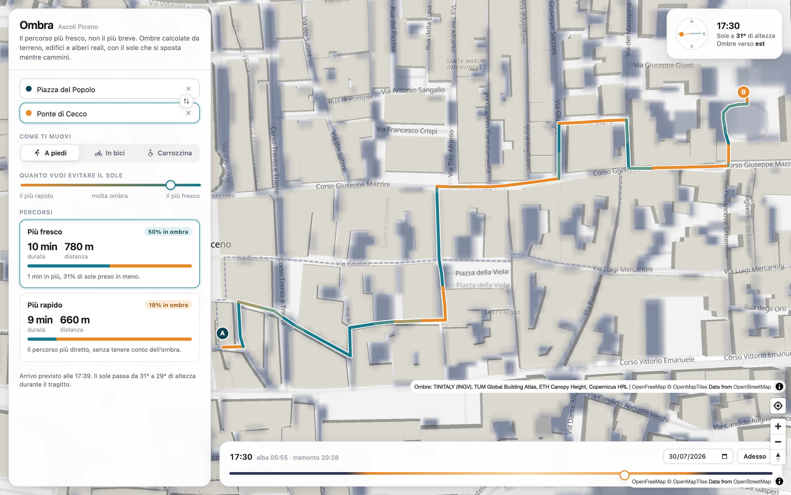

# Ombra

Un navigatore che non cerca il percorso più breve né il più veloce, ma **il più
fresco**: quello che passa più tempo all'ombra. Le ombre non sono stimate, sono
calcolate dalla geometria reale del terreno, degli edifici e degli alberi, e
tengono conto del fatto che il sole si sposta mentre ci si muove.

È una pagina statica: **il calcolo avviene nel browser**, non su un server.
Non c'è niente da tenere acceso.



---

## L'idea

Chi cammina d'estate in una città italiana non sceglie la via più corta: sceglie
il lato della strada con l'ombra. Ombra fa esattamente questo, ma su scala
urbana e con qualche minuto di anticipo.

Il punto interessante è che **il problema non è un cammino minimo classico**. Il
costo di una strada dipende da *quando* ci passi: un vicolo che alle 9 è in ombra
alle 15 è una fornace. E mentre cammini per mezz'ora il sole si sposta di una
decina di gradi. Il percorso va quindi calcolato su un grafo il cui costo cambia
nel tempo, con il tempo che avanza man mano che si esplora.

---

## Come è fatto

Il lavoro è diviso in due momenti che non si incontrano mai.

**Una volta per città**, sul portatile, si preparano i dati: si scaricano le
cinque fonti, si costruiscono superficie e rete stradale, e si riscrive tutto in
file statici. È il codice Python in `backend/`, che gira quando lo si lancia e
poi si spegne.

**Tutte le volte che serve un percorso**, nel browser: si scaricano i pochi file
che coprono il tragitto, si calcolano le ombre e si cerca la strada. È il codice
TypeScript in `web/src/ombra/`, dove il motore Python è stato riportato
funzione per funzione.

In mezzo non c'è nessun servizio. La pagina va su GitHub Pages come qualsiasi
sito fatto di file, e da lì funziona anche da un telefono in rete mobile.

Che il porting sia fedele non è un auspicio: `web/test/` confronta i numeri
delle due implementazioni sugli stessi casi. La posizione del sole coincide
fino alla nona cifra, le ombre coincidono **pixel per pixel**, e ventiquattro
percorsi di prova escono identici, geometria compresa. I valori di riferimento
li produce il Python con `python -m ombra.cli riferimenti`.

---

## Le fonti dei dati

Tutte pubbliche e gratuite, riprese dal plugin QGIS *EnviMet Protocol* e
riportate qui senza dipendenze da QGIS.

| Dato | Fonte | Uso |
|---|---|---|
| Terreno (10 m) | TINITALY 1.1, INGV | ombre del rilievo, pendenze |
| Edifici con altezza | TUM Global Building Atlas LoD1 | ombre del costruito |
| Altezza delle chiome (10 m) | ETH Global Canopy Height 2020 | ombre degli alberi |
| Densità di copertura arborea (10 m) | Copernicus HRL Tree Cover Density | quanto filtra ogni chioma |
| Rete stradale | OpenStreetMap via Overpass | grafo percorribile |

I due dataset più pesanti si leggono **in remoto**, senza scaricarli interi:

- gli edifici sono GeoParquet ordinati spazialmente, quindi con qualche range
  request si estraggono i pochi MB di *row group* che coprono l'area — un
  tassello da 658 MB si risolve in una decina di secondi;
- le chiome sono COG da 36000×36000 px, letti a finestra via `/vsicurl/`.

Solo il terreno TINITALY va scaricato per intero (~80 MB per tassello da 50 km),
e resta in cache: tasselli condivisi fra aree diverse si scaricano una volta sola.

---

## Come funziona il calcolo delle ombre

Il modello di superficie viene costruito su una griglia metrica a 2 m,
**allargata di 600 m oltre il bordo dell'area**: un palazzo o un versante appena
fuori proietta comunque la sua ombra dentro, e tagliando sul bordo la si
perderebbe proprio nelle ore in cui è più lunga.

L'ombra si calcola con lo shadow casting iterativo di Ratti & Richens nella
formulazione di Lindberg (SOLWEIG/UMEP): invece di tracciare un raggio per ogni
pixel, la superficie viene traslata ripetutamente lungo la direzione del sole e
abbassata della quota corrispondente. Il massimo cumulato descrive l'orizzonte
visto da ogni pixel. Costa un numero di operazioni vettoriali proporzionale alla
lunghezza dell'ombra, non al numero di ostacoli.

**Edifici e alberi non si trattano allo stesso modo.** Un muro è opaco; una
chioma lascia passare una frazione di radiazione che dipende dalla densità
fogliare (dal 5% di un filare fitto al 40% di un albero rado, letta dal dato
Copernicus). E soprattutto: nel modello 2.5D il pixel *sotto* un albero ha come
quota la cima della chioma, quindi risulterebbe soleggiato. L'ombra della
vegetazione va perciò proiettata **sulla superficie del suolo**, non su sé
stessa — altrimenti l'ombra degli alberi sparisce quasi del tutto.

La posizione del sole usa l'algoritmo NOAA. Verificato ad Ascoli: 70,58° al
solstizio d'estate contro i 70,6° attesi, 23,75° a quello d'inverno contro 23,7°,
mezzogiorno solare esatto al secondo.

---

## Come funziona il calcolo del percorso

1. La rete OSM viene tagliata ai nodi di giunzione e suddivisa in tratti da
   ~25 m. Per ognuno si salvano lunghezza, pendenza con segno (dal terreno),
   scomodità del fondo (dai tag `surface`) e permessi per modalità.
2. Le ombre vengono calcolate **al momento della richiesta**, ma solo dove e
   quando servono: un riquadro attorno al percorso più rapido e i soli istanti
   in cui lo si percorre, a passi di 15 minuti. Il riquadro viene allargato
   dal lato da cui arriva il sole, perché gli ostacoli che fanno ombra al suo
   interno stanno fuori, in quella direzione. Ne esce una matrice
   **[istanti × tratti]** con la frazione di ciascun tratto illuminata, che
   rende l'interrogazione istantanea durante il Dijkstra.
3. Il percorso è un **Dijkstra dipendente dal tempo** con euristica A*. Ogni
   etichetta porta con sé costo e tempo accumulati; il tempo determina quale
   riga della matrice usare per valutare il tratto successivo. Poiché la
   velocità di percorrenza non dipende dall'ora, vale la proprietà FIFO e
   Dijkstra resta corretto.

Per il routing l'ombra non viene proiettata su tutto il ritaglio: si valuta il
raggio solare **nei soli punti in cui il grafo la chiede**, qualche migliaio
invece di qualche milione. Il risultato è lo stesso bit per bit, perché gli
scostamenti della proiezione dipendono solo dal passo e non dal pixel, ma costa
settanta volte meno — ed è la ragione per cui il conto sta dentro un telefono.
Il raster intero serve ancora per disegnare le ombre sulla mappa, dove i punti
da sapere sono tutti.

Il costo di un tratto è:

```
tempo_percorrenza × (1 + α × esposizione × carico_solare)
```

dove `α` è quanto l'utente detesta il sole (il cursore nel pannello) e il
*carico solare* pesa il fatto che il sole delle 8 scalda molto meno di quello
delle 14. Viene sempre calcolato anche il percorso più rapido, come termine di
paragone.

### Le tre modalità

Velocità da funzione di Tobler a piedi, con penalità in salita molto più marcate
per bici e carrozzina, e rallentamento sul fondo sconnesso (poco a piedi,
moltissimo su ruote piccole).

Una nota di onestà sull'accessibilità: la pendenza qui è stimata da un modello
del terreno a 10 m su tratti di 25 m, con un errore dell'ordine del 4%. Usarla
come divieto al limite normativo dell'8% boccerebbe strade percorribili e
spezzerebbe la rete. Pendenza e pavimentazione pesano quindi soprattutto **come
costo**; restano divieti solo i gradini, i divieti espliciti e i fondi davvero
cedevoli. **Il risultato non sostituisce una verifica sul posto.**

---

## Avvio

L'applicazione da sola ha bisogno solo di Node 24+ (per il type stripping
nativo, che fa girare i test senza compilare nulla):

```bash
cd web
npm install
npm run dev        # http://localhost:5173
npm test           # confronto col motore Python
npm run prestazioni  # quanto costa un istante di ombre
```

I dati di Ascoli sono già nel repository. Python serve solo per **preparare
altre città**:

```bash
cd backend
python3 -m venv .venv
.venv/bin/pip install -r requirements.txt

# Scarica i dati, costruisce superficie e rete, ed esporta i file statici.
# Circa 3 minuti per una città di 3,5 km di lato.
.venv/bin/python -m ombra.cli prepara --luogo "Ascoli Piceno" --raggio 1.7
```

### Preparare altre aree

```bash
# Per nome (il centro abitato viene cercato su OpenStreetMap)
python -m ombra.cli prepara --luogo "Bologna" --raggio 2.5

# Con centro esplicito, se la ricerca per nome non convince
python -m ombra.cli prepara --luogo "Camerino" --centro 13.0674 43.1361 --raggio 1.2

# Riquadro esatto
python -m ombra.cli prepara --bbox 11.32 44.48 11.36 44.51 --area bologna-centro

python -m ombra.cli elenco                    # aree disponibili
python -m ombra.cli esporta --area bologna    # riesporta senza riscaricare
```

L'esportazione scrive in `web/public/dati/`, che va commesso: sono quei file
che il browser scarica. Una città di 3,5 km di lato pesa **6,4 MB**, di cui un
tragitto tipico ne usa qualche centinaio di kilobyte.

Cercare un comune per nome restituirebbe il **confine amministrativo**, il cui
centroide cade spesso in aperta campagna: ad Ascoli sbagliava di 5 km. Il sistema
risale quindi al nodo `place` dell'abitato, che è il centro vero.

### Pubblicare

`.github/workflows/pubblica.yml` costruisce il sito e lo mette su GitHub Pages
a ogni `push` su `main`, dopo aver eseguito i test di parità. Serve solo
attivare Pages in *Settings → Pages → Source: GitHub Actions*. Per pubblicare a
mano:

```bash
cd web
BASE=/nome-del-repository/ npm run build   # la cartella dist/ è il sito
```

HTTPS arriva incluso, ed è quello che serve al pulsante «la mia posizione».

---

## Struttura

Il motore esiste in due copie che devono dare gli stessi numeri: quella Python,
che è l'originale e serve a preparare i dati e a produrre i riferimenti, e
quella TypeScript, che è quella che gli utenti usano davvero.

```
backend/ombra/          preparazione dei dati, gira sul portatile
  sources.py            acquisizione delle cinque fonti
  surface.py            terreno, edifici e chiome su una griglia comune
  graph.py              rete percorribile da OpenStreetMap
  export.py             tasselli, grafo binario e manifesto per il browser
  riferimenti.py        i valori con cui si verifica il porting
  solar.py  shadow.py  live.py  exposure.py  router.py
                        il motore originale, ora anche metro di paragone
  cli.py                pipeline a riga di comando

web/src/ombra/          lo stesso motore, nel browser
  solar.ts              posizione del sole (NOAA) e carico radiativo
  shadow.ts             shadow casting; per punti singoli o su tutto il raster
  tiles.ts              lettura dei tasselli e ricomposizione del mosaico
  graph.ts              lettura del grafo binario
  live.ts               ombre ritagliate sul corridoio del tragitto
  exposure.ts           esposizione dei tratti nel tempo, interpolata
  router.ts             Dijkstra dipendente dal tempo
  overlay.ts            ombre come immagine per la mappa
  utm.ts  fusi.ts       proiezione e ora locale, senza librerie
  area.ts               mette insieme il tutto; rete.ts scarica e conserva
  worker.ts             il calcolo, fuori dal filo dell'interfaccia

web/src/
  components/           mappa, pannello, linea del tempo, quadrante solare
  lib/motore.ts         quello che prima era il client dell'API
  store.ts              stato dell'applicazione

web/test/               confronto numerico fra le due implementazioni
web/public/dati/        le città esportate: è questo che il browser scarica
```

---

## Limiti noti

- **Le chiome hanno pixel da 10 m.** In un centro storico un albero di cortile
  può sbordare sulla strada. Il dato ETH viene incrociato con la densità
  Copernicus, che ad Ascoli riduce la copertura dichiarata dall'81% al 46%, ma
  la risoluzione resta quella.
- **ETH maschera le superfici costruite**: sul Duomo di Milano il 97% dei pixel
  è nodata. Gli alberi isolati dei centri densi possono mancare del tutto.
- **Gli edifici sono LoD1**: prismi ad altezza costante, senza tetti a falda né
  sporgenze. Le ombre sono corrette in pianta, un po' generose sui colmi.
- **Niente ombre da pensiline, portici, tende o muri di cinta**: non sono in
  nessuno dei dataset.
- Il modello descrive la **radiazione diretta**. Una strada in ombra ma
  circondata da asfalto rovente resta calda: qui non si misura il comfort
  termico, si misura il sole che si prende.
- **La quota viaggia quantizzata al centimetro** e l'altezza delle chiome a
  25 cm, per far stare una città in pochi megabyte. Misurato sul centro di
  Ascoli: nessun pixel di differenza con il sole alto, uno su duemila nel caso
  peggiore, cioè con il sole a pochi gradi sull'orizzonte, quando le ombre sono
  lunghissime e un centimetro di quota ne sposta il bordo di qualche decimetro.
- **Le ombre disegnate sulla mappa** usano la piena risoluzione da vicino e una
  veduta a 8 m quando si guarda tutta la città: a quello zoom un pixel dello
  schermo vale una ventina di metri, e scaricare quattro megabyte di tasselli
  per un dettaglio invisibile sarebbe rete pagata da chi guarda.

---

## Licenze dei dati

TINITALY (INGV) CC BY 4.0 · Global Building Atlas (TUM) CC BY 4.0 · ETH Global
Canopy Height CC BY 4.0 · Copernicus HRL, termini Copernicus · OpenStreetMap
ODbL · mappa di base OpenFreeMap.
